# Christopher Knudsen

**ctrlcmdshft** · New Jersey

Building tools for the things that should just work.

Tinkerer building Mac menu bar apps in Swift and SwiftUI, Homebridge plugins, and Unraid home-server and self-hosted tooling.

  

## Projects

Original repositories, not forks. Each panel opens the repo.

  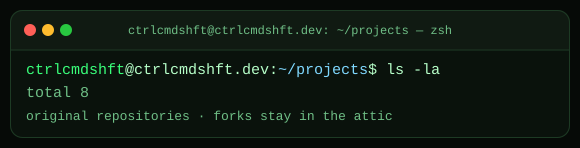

<a href="https://github.com/ctrlcmdshft/homebridge-hubspace-platform">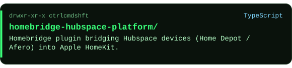</a>
<a href="https://github.com/ctrlcmdshft/macos-network-automount">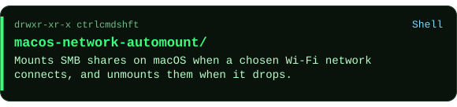</a>
<a href="https://github.com/ctrlcmdshft/RedditQuickAccess">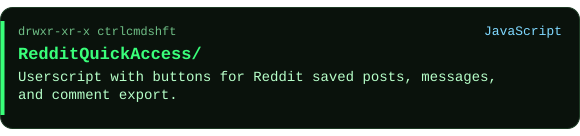</a>
<a href="https://github.com/ctrlcmdshft/BetterDiscordPatcher">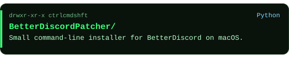</a>
<a href="https://github.com/ctrlcmdshft/ScreenMailer-PowerShell">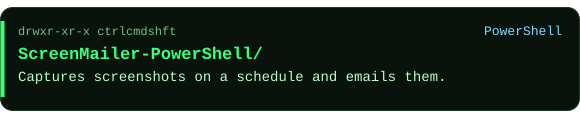</a>
<a href="https://github.com/ctrlcmdshft/unraid-trellis">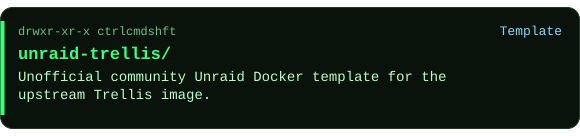</a>
<a href="https://github.com/ctrlcmdshft/caddy-custom">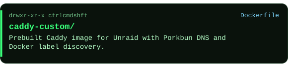</a>
<a href="https://github.com/ctrlcmdshft/discord-plugins">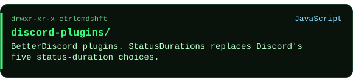</a>

## Stack

**Languages:** Swift, SwiftUI, TypeScript, JavaScript, Python, Shell.

**Tools:** Xcode, Zed, Git, Homebrew, Node.js (pnpm), Homebridge, Unraid, Docker (OrbStack), Vercel, Cloudflare, Firebase.

**Systems:** macOS, iOS.

  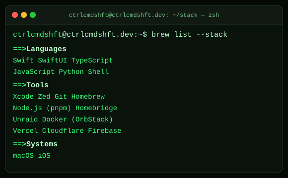

## Currently

- Learning Swift and building macOS menu bar apps
- Tinkering with iOS push notifications and home-server automation

  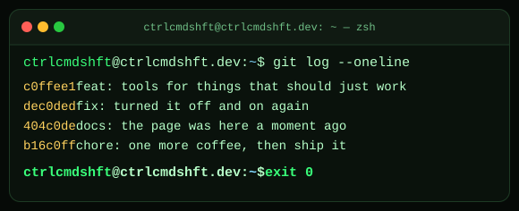

